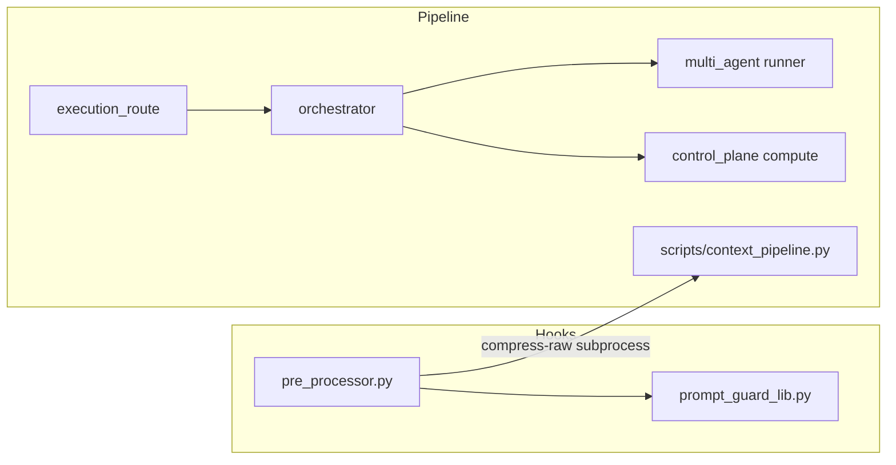

# Code Review — token-reducer working tree

**Branch:** `mcp` (ahead of `origin/mcp` by 4 commits)  
**Scope:** All uncommitted work — 34 tracked files changed (~1,037 insertions / ~465 deletions) plus new modules (hooks refactor, `context_intelligence/`, `execution_route.py`, `multi_agent/`, control-plane extensions, trace replay/export, product defaults, Rust helpers, 9 new test files).  
**Method:** `git diff` on tracked paths; full read of new hook layer, execution routing, orchestrator wiring, control-plane `compute.py` / `why_lines.py`; `python -m pytest tests -q`.  
**Generated:** 2026-05-21

---

## Code Review

**Verdict:** APPROVE  
**Confidence:** HIGH

### Summary

This working tree turns token-reducer into a layered product: pre-hook guardrails (`prompt_guard_lib` + `pre_processor.py`), execution-tier routing (`simple` / `tool` / `complex`), context intelligence (D₀/D₁ heuristics), a four-phase multi-agent compression sequence, and a richer control-plane trace bundle (signal snapshot, gate decision, structured why-lines, replay validation). Hooks are consolidated without shell invocation; subprocess compression uses a fixed argv list. **319 tests passed** in ~3.5 minutes. No P0/P1 defects were found in reviewed paths; remaining items are naming, observability, timeout alignment, and test gaps.

### Findings

| Priority | Issue | Location |
|----------|-------|----------|
| P2 | Hook `timeout` is 12s in `hooks.json` but `communicate(timeout=30)` in compression path — outer kill wins; inner timeout is misleading and failures may look like truncation | `hooks/hooks.json`, `hooks/prompt_guard_lib.py` |
| P2 | Rejected prompts (`rejectInput`) still increment session turn counter before the block check | `hooks/prompt_guard_lib.py` (`run_pre_process`) |
| P2 | `trim_to_max_words` normalizes whitespace when truncating; under budget returns original layout — doc/name can over-promise | `src/lib.rs` |
| P2 | `bug_fix_error_terms_prefixed` metadata key implies prefix semantics; code checks list membership of exception names in `focus_terms` | `scripts/token_reducer/subagents/router.py` |
| P2 | `prompt_guard_state.json` written without atomic replace or file lock — concurrent submits could corrupt JSON | `hooks/prompt_guard_lib.py` (`save_state`) |
| P2 | Subprocess compression ignores `stderr` — harder to diagnose pipeline failures in production | `hooks/prompt_guard_lib.py` |
| P3 | No dedicated tests for hook JSON contract (`rejectInput`, `transformedPrompt`, turn reminders) | `hooks/` |
| P3 | No Python-boundary tests for new Rust `collapse_blank_lines` / `trim_to_max_words` | `src/lib.rs`, `tests/` |
| P3 | `post_processor.py` is intentional stdin passthrough until Stop/Session hooks exist | `hooks/post_processor.py` |
| P3 | `CLAUDE_PLUGIN_ROOT` unset → state under CWD `.cache/` and compression shim may miss — dev-only footgun | `hooks/prompt_guard_lib.py` |

### Details

#### [P2] Hook timeout mismatch

**File:** `hooks/hooks.json:10`, `hooks/prompt_guard_lib.py:183`

Claude Code kills the hook at **12 seconds**. The compression subprocess waits up to **30 seconds**, so the effective cap is 12s. Long compress runs will hit the hook timeout and fall through to word truncation (or empty hook output depending on host behavior), which is confusing when debugging.

**Suggested fix:** Align both to the same value (e.g. `communicate(timeout=10)` with hook `timeout: 11`) or document that compression is best-effort within the hook budget.

```python
# prompt_guard_lib.py — example alignment
COMPRESS_TIMEOUT_S = 10
# hooks.json: "timeout": 11
compressed_packet, stderr = process.communicate(input=prompt, timeout=COMPRESS_TIMEOUT_S)
```

#### [P2] Turn counter advances on blocked prompts

**File:** `hooks/prompt_guard_lib.py:138-168`

Turns are incremented and persisted before word-count guardrails run. A user repeatedly submitting an over-limit prompt will still climb toward auto-compact / reset reminders even though input was rejected.

**Suggested fix:** Move turn increment after the early `rejectInput` return, or use a separate counter for “accepted” turns only.

#### [P2] `trim_to_max_words` whitespace semantics

**File:** `src/lib.rs:129-139`

Truncation uses `split_whitespace()` and `join(" ")`, so code layout changes when the cap applies. Callers that need preserved newlines should only use this helper when input already fits, or pair with `collapse_blank_lines` and document normalization.

**Suggested fix:** Extend the Rust doc comment on `trim_to_max_words` to state explicitly that over-budget output is single-spaced.

#### [P2] Misleading specialization flag name

**File:** `scripts/token_reducer/subagents/router.py:100-102`

The flag is logically “exception names from the query appear in `focus_terms`.” Renaming to e.g. `bug_fix_error_terms_in_focus` avoids confusion if the JSON field is not yet a stable external API.

#### [P2] Session state durability

**File:** `hooks/prompt_guard_lib.py:124-126`

`save_state` writes directly with `write_text`. A crash mid-write or concurrent hook invocations can corrupt `prompt_guard_state.json`; `load_state` then returns `{"sessions": {}}` and resets turn tracking.

**Suggested fix:** Write to a temp file and `os.replace`, or use a short file lock.

#### [P2] Subprocess stderr discarded

**File:** `hooks/prompt_guard_lib.py:183`

`communicate` assigns stderr to `_`. Logging stderr on non-zero exit (even to a debug env flag) would speed up hook failure diagnosis without changing security posture (`sys.executable` + list argv, no shell).

### Recommendation

Safe to merge from a correctness standpoint given green tests and bounded hook surface. Before release, align hook/compress timeouts, consider not bumping turns on `rejectInput`, and add a small hook contract test module. Optional polish: rename `bug_fix_error_terms_prefixed`, atomic session state writes, and Rust helper tests once `token_reducer_core` is built in CI.

---

## Architecture snapshot (working tree)



| Layer | Responsibility |
|-------|----------------|
| **Hooks** | UserPromptSubmit guardrails, optional compress/truncate, session turn hygiene |
| **execution_route** | Tier classification, skill pick, routing plan (output cap, lean/full subagents) |
| **context_intelligence** | D₀/D₁ decisions, strategy nudge, telemetry |
| **multi_agent** | cost_optimizer → retriever → reasoning_enhancer → compressor phases |
| **control_plane** | Signal fusion, gate policy, `DecisionTraceV2`, why-lines, trace bundle |
| **trace_replay** | Load/validate on-disk trace dirs; optional gate-patch diff |

---

## Security & boundaries

| Topic | Assessment |
|-------|------------|
| Command injection | **OK** — hook uses `subprocess` with list argv; no `shell=True`. |
| Path traversal | **OK** — state and cache paths rooted under `CLAUDE_PLUGIN_ROOT` when set. |
| Secrets in repo | No new credential patterns in reviewed code. |
| `trace_replay` gate-patch | Parses user JSON; used for offline replay — not a runtime network boundary. |
| Plugin payload | `_routing_debug` / `_context_adaptation` are diagnostic; ensure hosts do not log sensitive query text in production. |

---

## Verification

```text
319 passed in 213.28s (0:03:33)
```

Command: `python -m pytest tests -q`

Notable new/extended test modules: `test_execution_route.py`, `test_context_intelligence.py`, `test_multi_agent.py`, `test_trace_replay.py`, `test_why_lines.py`, `test_product_defaults.py`, `test_routing_plan.py`, `test_compression_intent_model.py`, `test_feedback_loop.py`.

---

## Positive observations

- **Hook refactor** — Shared `prompt_guard_lib` with thin `pre_processor.py` / `userprompt_guard.py` shims reduces duplication and keeps `hooks.json` on a single entrypoint.
- **Execution routing** — Clear tier gates (`skip_subagents`, `skip_lsp`, retrieval scale) wired through cache keys and orchestrator stages.
- **Plugin dedupe fix** — `plugin_output.py` dedupes by `chunk_id` instead of fragile `(file, symbol_name)` pairs.
- **Control plane** — `why_lines` are structured projections with validation; trace bundle stays derived from spine, not a second source of truth.
- **Product defaults** — `apply_plugin_product_defaults` enables feedback/adaptation when running as a plugin without forcing env vars on users.

---

*Re-run review after large refactors or before merge to `main`.*
